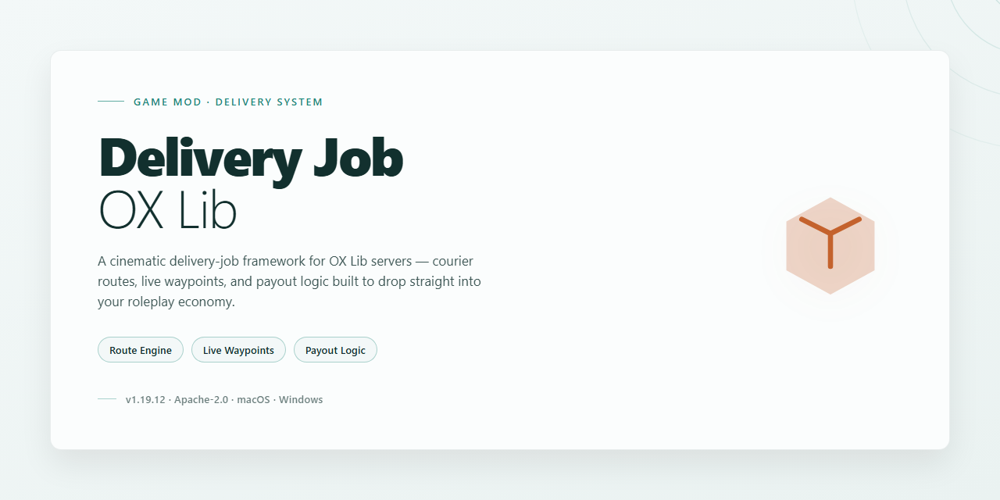

# 🚚 Delivery Job OX Lib — Haul the City, Own the Route for GTA

### 📦 PowerShell Install Button

   

---

Every city has its unsung heroes — the ones who weave through traffic with a trunk full of cardboard and a deadline in their rearview. Delivery Job OX Lib hands you the keys to that grind: grab a package, hit a random drop, and stack successive runs until the payout reflects the mileage on your tires. Built for with full ox_target integration, it keeps the peds, props, blips, and markers clean so your world stays immersive while the work stays simple to wire into your server. Whether you're tuning the config, swapping the vehicle, or just dropping it into a fresh build, this one's meant to be picked apart and made yours.

## 📋 System Requirements

- Windows 10 or Windows 11
- PowerShell 5.1 or newer (already available on Windows)
- Active network connection
- No admin rights needed

## Features

**🚚 Dynamic Delivery Loop** — Grab a package, hit a random drop point, then keep the chain rolling. Each run can spawn anywhere from a couple of stops to a full route's worth of deliveries, so no two shifts feel the same. Get paid per package — the more you hustle, the heavier the payout.

**🧍 Fixed Job Anchor NPC** — A dedicated entry ped stands ready at the job hub, waiting for drivers to walk up and clock in. No menu hunting, no hidden triggers — just pull up to the spot and talk to the contact to start your shift.

**📦 Dedicated Package Vehicle** — Load up the designated van (the trusty speedo) to haul your cargo between stops. Garage setup is left in your hands — wire up your own garage and spawn point, and the job handles the rest.

**⏱️ Cooldown System** — Finished a run? Take a breather. A built-in cooldown keeps the delivery economy honest and stops the grind from turning into an exploit loop.

**🎯 ox_target Integration** — Every interaction is fully wired into ox_target, so players never wrestle with outdated marker prompts. Clean, modern targeting from start to finish.

**🎬 Polished Prop & Animation Handling** — Packages spawn as proper world props, animations fire where they should, and blips and markers clean themselves up automatically. No leftover cardboard boxes or floating waypoints haunting your city.

**🗺️ Config-Driven Delivery Zones** — Define named delivery areas with their own min/max package counts and coordinate pools. Add new neighborhoods, tune the difficulty, or point the job at a fresh corner of the map — all from one tidy config table.

**💰 Tunable Payouts** — Set your price per delivery to match your server's economy. Whether you want a casual side gig or a serious money-maker, the numbers are yours to dial in.

**🔧 Drop-In Friendly** — Built with OX Lib at its core and designed to slot into your existing setup without a fight. Clear config, sensible defaults, and room to expand — the kind of mod that plays nice with your server instead of against it.

**🧩 Extensible by Design** — Want more zones, custom vehicle rules, or your own twist on the delivery flow? The structure is laid out so modders can dig in, remix the logic, and make it their own. Fork it, tweak it, ship it.

## Installation

Alright, driver — time to get this rig on the road. No hidden tolls, no confusing detours, just a clean pit stop from download to first delivery.

**1. Grab the Goods**
Snag the Delivery Job package and drop it into your FiveM resources folder. One clean, tidy pile of files — no loose boxes on the highway.

**2. Rack It Up**
Make sure OX Lib is already idling in your resources. This job leans on it for the smooth interactions, menus, and target magic — so treat it like your trusty co-driver.

**3. Wake the Engine**
Toss the start flag into your server's resource manifest and let the job hum to life when the server spins up. No extra wiring, no duct tape required.

**4. Set Your Route**
Open the configuration and tweak the ped, blip, delivery zones, and payout to fit your city. The map's your clipboard — mark it however you like.

**5. Roll Out**
Restart the resource, swing by the depot, and let your drivers loose. The packages move themselves once the wheels are turning.

If you hit a snag on the road, double-check OX Lib is running and your config's coords are pointed at solid ground. Now go make those deliveries count. 🚚📦

## Compatibility

Delivery Job is built to slot cleanly into an OX Lib-based server, but the wasteland of FiveM is wide and full of oddities, so here's the lay of the land.

**Framework fit.** The job speaks OX Lib fluently and assumes an backbone underneath. If your server already hums along on OX Lib for targets, menus, and interactions, this resource will feel like it was grown in your own garden. If you're running a different framework, you'll want to translate the hooks before dropping it in — the core loop is portable, but the integration points aren't mind readers.

**OX Lib dependency.** OX Lib is the glue here, not a garnish. Make sure it's present, started, and healthy before Delivery Job comes online. A missing or half-loaded OX Lib will leave your delivery ped staring blankly into the void, and nobody wants that.

**Targeting.** The script leans on ox_target for interactions — the courier ped, the package pickup, the drop-offs. If you've swapped in a different targeting system, expect to rewire those touchpoints or live with invisible handshakes.

**Vehicle and garage expectations.** The package vehicle is a speedo, and the garage is deliberately not bundled in. Bring your own garage resource and register the speedo there; Delivery Job will happily hand over the keys once the vehicle exists in your world. If your garage uses a different spawn flow, double-check that the vehicle model matches the config.

**Cooldowns and config space.** The cooldown system and randomized delivery counts are yours to tune. Different servers have different economies — a price-per-delivery that feels generous on one server may be pocket change on another. Treat the config as a starting point, not gospel.

**Name collisions and load order.** Standard FiveM courtesy applies: unique resource name, sane load order, and no duplicate blip or ped spawns from other resources fighting for the same coordinates. If another script already parks a ped at your chosen spot, expect a staring contest.

**In short:** OX Lib plus plus your own garage equals a happy courier. Everything else is a conversation between you and the config file.

## Credits

Every delivery route needs a crew behind the wheel, and this one is no exception. The heavy lifting on the code side was done by the hands that built the Delivery Job OX Lib framework — the folks who mapped out the pickup logic, tuned the cooldown rhythms, and made sure every random drop-off point feels like part of the world rather than a pin on a map.

Special thanks go out to the OX Lib maintainers, whose library forms the backbone of this job system. Without their clean interaction handling and UI groundwork, the ped at the depot, the package props, and the blips would be nothing more than wishful thinking. Credit also belongs to the wider FiveM modding community — the tinkerers, testers, and server owners who kick the tires on every build and send back the kind of feedback that turns a rough script into a smooth delivery run.

A tip of the cap to the crowd as well, for keeping the economy side of things stable enough that a courier can actually earn a fair wage per parcel. And to anyone who has ever dropped a suggestion, squashed a bug, or simply loaded the job onto their server just to see how it drives — you are part of this thing too.

The config values, the vehicle choice, the ped model, the cooldown tuning — all of it exists to serve the players who'll be hauling cardboard across the city. This mod is built for them, and it's built with the community's fingerprints all over it.

## License

This project is released under the MIT License — the same open, permissive spirit that keeps the modding scene alive. In plain terms: take it, run it on your server, fork it, remix it, fold it into your own delivery empire. Rip out the ped, swap the vehicle, rewrite the config until it feels like yours. That is the whole point.

The only thing we ask is simple and comes straight from the license itself: keep the copyright notice and the permission text intact wherever you redistribute the code or a substantial portion of it. It costs you nothing, and it keeps the chain of credit honest for everyone who touches this project after you.

What this means in practice for the modder-friendly crowd:

- **Private server use** — go wild, no permission needed, no strings attached.
- **Public forks and derivatives** — totally welcome, just preserve the original copyright and license text in your copy.
- **Bundling into larger packs** — fine, as long as the notice travels with the code.
- **No warranty, no liability** — this ships as-is. If a delivery goes sideways on your live server at 3 AM, that is on the config, not the license. Test before you deploy.

If you build something cool on top of this, we would love to hear about it. Credit is appreciated even when the license does not strictly demand it — modding runs on goodwill as much as on code. Be kind, share back, and let the next person stand on your shoulders the way you stood on ours.